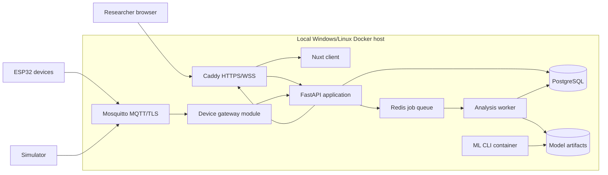
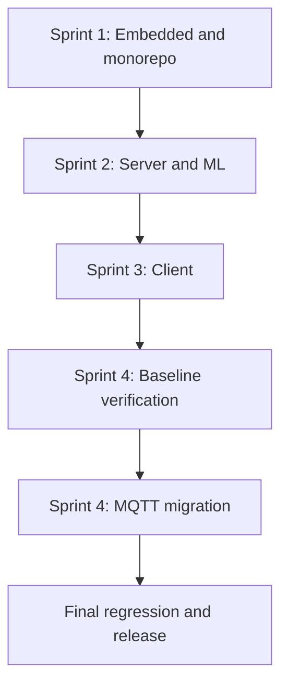

# Plethos Production Preparation Plan

**Version:** 1.0

**Date:** 2026-08-04

**Status:** Approved planning baseline

**Execution model:** four sequential sprints, each owned by a dedicated lead agent

## 1. Purpose

This plan prepares Plethos for reproducible development and deployment on a local Windows or Linux machine using Docker. It covers the ESP32 firmware and simulator, the FastAPI backend and ML workflow, the Nuxt client, and final production verification.

The finished project must allow another developer to:

- clone one monorepo and start the application through Docker Compose;
- modify and validate the client, server, embedded firmware, and simulator;
- collect and export Plethos recordings;
- import external datasets through explicit dataset adapters;
- train, evaluate, package, and register models through a CLI-first workflow;
- add recording-level analyses other than the current fixed Quality analysis;
- connect multiple physical devices over the public Internet;
- deploy the final device transport through Mosquitto MQTT over TLS;
- reproduce releases from clean branches and atomic commits.

## 2. Fixed decisions

| Area | Decision |
|---|---|
| Deployment | Docker Compose on Windows Docker Desktop or Linux Docker Engine |
| Repository | One monorepo containing client, server, embedded, ML, contracts, and infrastructure |
| ML workflow | CLI-first; no training UI in the initial production scope |
| Initial device transport | Existing secure WebSocket transport |
| Final device transport | Mosquitto MQTT over TLS |
| Browser live transport | WebSocket remains in production |
| Backend shape | Modular monolith plus a separate analysis worker |
| Initial backend scale | One API/device-ingestion worker because live state is process-local |
| UI strategy | Keep and improve the existing custom Vue UI |
| Orchestration | One lead agent per sprint; leads delegate bounded work to junior subagents |
| Agent isolation | Every lead and junior works in a dedicated Git worktree |
| Agent communication | Codex agents communicate only with Codex agents; Claude agents communicate only with Claude agents |
| Git policy | One branch per sprint, atomic commits, lead-only commit and push |

## 3. Non-goals

- Kubernetes or multi-host orchestration.
- One microservice or container per analysis type.
- A browser-based dataset-training interface.
- Arbitrary uploaded Python plugins executed by the public server.
- Immediate horizontal scaling of live measurement processing.
- Replacing Chart.js or rewriting the specialized PPG visualization.
- Migrating the browser live stream to MQTT.
- Replacing the custom UI with another component framework.

## 4. Current baseline and constraints

The current project already contains:

- Nuxt client code with custom SCSS and Chart.js visualizations;
- FastAPI endpoints for devices, measurements, recordings, studies, participants, Quality analysis, and the assistant;
- PostgreSQL persistence through SQLAlchemy;
- an ESP32 MAX30102/MAX30105 firmware implementation;
- a Python device simulator;
- a BUT-PPG Random Forest training script;
- passing server tests and a successful Nuxt production build.

Known constraints that the sprints must resolve:

- the root repository has no established monorepo history while client and server are nested repositories;
- no Dockerfiles, root Compose stack, CI pipeline, or versioned database migrations exist;
- firmware contains hardcoded network credentials and a fixed server address;
- device connections, measurement sessions, buffers, metrics, and browser subscribers are process-local;
- Quality is hardcoded through storage, routes, model loading, assistant context, and client rendering;
- external datasets and model artifacts have no shared versioning or acquisition workflow;
- the public interfaces have no complete operator/device authentication system;
- the existing device WebSocket is suitable for initial delivery but not the final device-fleet transport.

## 5. Target production architecture



Production public ports:

- `443` for the web client, REST, and browser WebSocket;
- `8883` for MQTT over TLS;
- optionally `80` for certificate redirects or challenges.

PostgreSQL, Redis, the worker, and artifact storage must remain private to the Docker network.

## 6. Target monorepo layout

```text
plethos/
├── client/
├── server/
├── embedded/
│   ├── pulso_esp32/
│   └── simulator/
├── ml/
│   ├── plethos_ml/
│   │   ├── analyses/
│   │   ├── datasets/
│   │   ├── features/
│   │   ├── training/
│   │   └── artifacts/
│   └── tests/
├── contracts/
│   ├── openapi/
│   ├── websocket/
│   └── mqtt/
├── infra/
│   ├── caddy/
│   ├── docker/
│   └── mosquitto/
├── docs/
│   └── handoffs/
├── data/                  # ignored local datasets
├── artifacts/             # ignored local model outputs
├── compose.yaml
├── compose.override.yaml
├── .env.example
├── .gitattributes
├── AGENTS.md
└── README.md
```

## 7. Sprint and agent ownership

| Sprint | Branch | Lead | Lead effort | Junior | Junior effort |
|---|---|---|---|---|---|
| 1. Embedded | `codex/sprint-1-embedded` | GPT-5.6 Sol | Medium | GPT-5.6 Luna | High |
| 2. Server | `codex/sprint-2-server` | Claude Opus 5 | High | Claude Sonnet 5 | High |
| 3. Client | `codex/sprint-3-client` | Claude Opus 5 | High | Claude Sonnet 5 | High |
| 4. Postprod | `codex/sprint-4-postprod` | GPT-5.6 Sol | High | GPT-5.6 Luna | High |

Model names in this table are orchestration assignments. The executing platform must map them to valid provider/model identifiers before starting a sprint.

## 8. Common agent operating protocol

### 8.1 Lead responsibilities

Every lead must:

1. Read the root `AGENTS.md`, this plan, and relevant package documentation.
2. Verify the current branch, dedicated lead-worktree path, worktree status, and sprint base commit.
3. Break the sprint into bounded tickets before editing.
4. Delegate independent, clearly scoped tickets only to the assigned same-provider junior subagent.
5. Keep architecture decisions, integration work, reviews, and release decisions under lead ownership.
6. Review every junior diff and rerun relevant validation locally.
7. Reject work that changes unrelated files or weakens an established contract.
8. Create atomic commits after each accepted ticket or tightly coupled ticket group.
9. Push the sprint branch after each validated commit or small validated sequence.
10. Produce a final sprint report with commits, tests, known risks, and handoff notes.

### 8.2 Junior responsibilities

Every junior must:

- work only inside the dedicated junior worktree assigned to the ticket;
- work only on the assigned bounded ticket;
- inspect relevant code and tests before editing;
- preserve unrelated user changes;
- add or update tests for changed behavior;
- run the smallest meaningful validation suite;
- report changed files, validation output, assumptions, and unresolved risks;
- never merge, rebase, force-push, or push a branch;
- never create broad architectural interfaces without lead approval;
- stop and notify the lead if the ticket requires a contract or scope change.

### 8.3 Delegation rules

- One junior task must have one observable outcome.
- A junior task must name allowed directories and expected tests.
- Leads should delegate discovery, isolated implementation, fixtures, documentation, or test additions.
- Leads should not delegate final integration, security acceptance, schema ownership, or release approval.
- Two agents must not edit the same file concurrently.
- Every delegated ticket must use a separate junior worktree rather than the lead worktree.
- A lead may spawn and message only the junior assigned to the same provider family.
- Junior results are proposals until reviewed by the lead.

### 8.4 Shared safety rules

- Never commit credentials, dataset contents, private model artifacts, or local `.env` files.
- Never use destructive Git operations such as `reset --hard`, `clean -fd`, or force-push.
- Never discard pre-existing changes without explicit authorization.
- Never flash physical firmware or modify production data without explicit user approval.
- Do not expose PostgreSQL, Redis, internal worker ports, or management interfaces publicly.
- Treat model files loaded through pickle/joblib as trusted internal artifacts only.
- Public device and operator communication must use authenticated encrypted transport.

### 8.5 Agent communication isolation

- Codex leads may call, message, wait for, or continue only Codex juniors.
- Claude leads may call, message, wait for, or continue only Claude juniors.
- Claude agents must never call or message Codex agents.
- Codex agents must never call or message Claude agents.
- No agent may use another provider as an implicit reviewer or background worker.
- Cross-provider and cross-sprint handoff occurs only through reviewed commits, remote branches, pull-request artifacts, committed files under `docs/handoffs/`, and the project owner/orchestrator.
- Agents must not assume access to another provider's conversation, private reasoning, or uncommitted worktree state.
- If progress requires a decision from an agent of the other provider, the active lead writes a handoff/blocker note and asks the project owner to route it. The active lead does not contact the other agent directly.

## 9. Git, branch, and commit protocol

### 9.1 Worktree isolation

The coordination checkout is for project-owner inspection only. Agents must not perform implementation work in it.

Every lead receives a dedicated persistent worktree for its sprint integration branch. Every junior ticket receives another dedicated worktree created from the current sprint branch.

Suggested layout outside the repository directory:

```text
../plethos-worktrees/
├── s1-embedded-lead/
├── s1-e003-junior/
├── s2-server-lead/
├── s2-s009-junior/
├── s3-client-lead/
├── s3-c006-junior/
├── s4-postprod-lead/
└── s4-p011-junior/
```

Example lead-worktree creation:

```bash
git worktree add ../plethos-worktrees/s1-embedded-lead \
  -b codex/sprint-1-embedded main
```

Example local junior task branch and worktree:

```bash
git branch codex/task-s1-e003-embedded codex/sprint-1-embedded
git worktree add ../plethos-worktrees/s1-e003-junior \
  codex/task-s1-e003-embedded
```

For Claude-owned sprints, use local junior task names such as `claude/task-s2-s009-analysis`. Junior task branches are local integration aids and are never pushed; the sprint branch remains the only remote implementation branch.

Worktree rules:

- an agent may edit only its assigned worktree;
- an agent may not switch its worktree onto another agent's branch;
- leads may inspect junior diffs read-only but must not edit inside the junior worktree;
- juniors may not edit, stage, or clean the lead worktree;
- each new junior ticket starts from the latest validated sprint-branch commit;
- two worktrees must not receive overlapping file assignments at the same time;
- task worktrees are removed only after the lead confirms that the patch was integrated, committed, validated, and preserved remotely or in the sprint history.

### 9.2 Branch lifecycle

Each sprint begins only after the prior sprint branch is reviewed and merged into `main`:

```text
main
  └── codex/sprint-1-embedded
main after Sprint 1 merge
  └── codex/sprint-2-server
main after Sprint 2 merge
  └── codex/sprint-3-client
main after Sprint 3 merge
  └── codex/sprint-4-postprod
```

Required project-owner/orchestrator preparation before assigning the lead:

```bash
git switch main
git pull --ff-only
git worktree add ../plethos-worktrees/sprint-N-lead \
  -b codex/sprint-N-name main
```

The lead pushes only the assigned sprint branch. Merging into `main` requires review and explicit project-owner approval.

### 9.3 Atomic commit rules

An atomic commit must:

- implement one coherent behavior or infrastructure change;
- include its directly related tests and documentation;
- leave the repository buildable;
- avoid mixing formatting, refactoring, and feature behavior unless inseparable;
- exclude generated caches, build output, datasets, secrets, and local artifacts;
- use an imperative Conventional Commit message.

Examples:

```text
chore(repo): consolidate plethos packages into monorepo
refactor(embedded): isolate sensor acquisition from transport
fix(embedded): resume sample indices after reconnect
feat(server): add generic analysis run persistence
feat(ml): add BUT-PPG dataset adapter
feat(client): render recording analyses from definitions
test(postprod): add multi-device compose smoke test
feat(mqtt): add authenticated Mosquitto device transport
```

Before every commit, the lead must inspect:

```bash
git status --short
git diff --check
git diff --staged
```

### 9.4 Junior-to-lead integration

Juniors do not create sprint commits. A completed junior task is transferred as an uncommitted patch:

1. The junior leaves only ticket-related changes in the junior worktree.
2. The junior reports the worktree path, changed files, tests, and assumptions to its same-provider lead.
3. The lead inspects the junior diff read-only.
4. The lead exports or applies that diff into the lead worktree without editing the junior worktree.
5. The lead reviews the resulting lead-worktree diff and runs validation again.
6. The lead creates the atomic sprint commit and pushes the sprint branch.
7. The junior worktree remains available until integration is confirmed; cleanup must not destroy the only copy of any change.

This keeps agents isolated while ensuring that the lead remains the author and owner of every pushed sprint commit.

### 9.5 Push and handoff rules

- Push after validation; do not accumulate the entire sprint in one commit.
- Never force-push a reviewed sprint branch.
- Record the pushed commit SHA in the sprint report.
- The final sprint report must identify any intentionally deferred work.
- If a pull request is used, the lead may create it but must not self-approve or merge it.
- Cross-provider handoffs must be committed under `docs/handoffs/`; they must not depend on direct Claude-to-Codex or Codex-to-Claude messages.

## 10. Shared quality gates

Every sprint must satisfy the gates relevant to its scope:

- no committed secrets;
- clean dependency installation from lockfiles;
- tests cover public behavior rather than implementation details;
- contracts and examples match runtime behavior;
- Docker images run as non-root where practical;
- health checks reflect real dependencies;
- Windows and Linux path assumptions are documented;
- logs contain identifiers and actionable errors without credentials or raw secrets;
- public interfaces remain versioned;
- documentation is updated in the same atomic commit as behavior.

---

# Sprint 1 — Embedded

## 11. Sprint objective

Make the embedded portion safe to share, reproducible to build, easy to modify, resilient over public WSS, and prepared for a later MQTT adapter without implementing MQTT yet.

## 12. Sprint scope

Primary directories:

```text
embedded/
contracts/websocket/
infra/docker/embedded/
```

The sprint may establish root monorepo files required by all later sprints. It must not redesign server persistence or client UI.

## 13. Embedded task backlog

### E-001 — Establish the monorepo baseline

- Preserve client and server histories through an agreed history-import strategy.
- Remove nested-repository ambiguity only after history preservation is verified.
- Add root `.gitignore`, `.gitattributes`, `.env.example`, README, and package navigation.
- Document Windows Docker Desktop and Linux Docker Engine prerequisites.

Acceptance:

- one root Git repository owns all project files;
- histories remain discoverable;
- a clean clone contains no build output or local datasets.

### E-002 — Remove embedded secrets

- Rotate the currently exposed Wi-Fi password.
- Remove Wi-Fi credentials and fixed host values from firmware source.
- Add a safe configuration example.
- Select ignored build configuration or ESP32 NVS provisioning.
- Document device ID, Wi-Fi, server hostname, port, TLS, and token provisioning.

Acceptance:

- secret scanning finds no real credentials;
- firmware can be configured without source edits.

### E-003 — Deepen the firmware module

Separate the one-file sketch into cohesive internal areas while keeping a small runtime interface:

```text
DeviceRuntime
├── configure()
├── connect()
├── start_measurement()
├── stop_measurement()
└── loop()
```

Internal implementation may contain:

- sensor acquisition;
- sample averaging;
- batching;
- protocol serialization;
- connection lifecycle;
- configuration and diagnostics.

Acceptance:

- sensor acquisition does not depend directly on WebSocket implementation details;
- transport code does not own signal-sampling rules;
- existing sampling behavior remains verified.

### E-004 — Version the device protocol

- Add `protocol_version` or `schema_version` to device messages.
- Define JSON fixtures for hello, samples, commands, acknowledgements, logs, and finished events.
- Keep device IDs and measurement IDs consistent with server rules.
- Define maximum batch size and payload-size expectations.

### E-005 — Secure public WSS readiness

- Replace fixed LAN addressing with a provisioned hostname.
- Add TLS/WSS support and certificate validation.
- Add a provisioned device credential to the hello/authentication flow.
- Ensure credentials are never logged.
- Keep server-side enforcement for Sprint 2.

### E-006 — Reconnection and data-integrity behavior

- Use bounded exponential reconnect backoff with jitter.
- Preserve stable device identity.
- Continue monotonic sample indices after transient reconnect where safe.
- Attach stable batch identifiers.
- Report dropped samples and buffer overflow explicitly.
- ensure stale start/stop acknowledgements cannot affect a new measurement.

### E-007 — Simulator parity and failure modes

- Align simulator fixtures with the versioned protocol.
- Add configurable disconnect, reconnect, duplicate-batch, missing-batch, noise, and malformed-payload scenarios.
- Support multiple simulator instances with distinct device IDs.
- Keep deterministic seeds available for tests.

### E-008 — Reproducible embedded build tooling

- Pin PlatformIO platform, board, framework, and libraries.
- Add a containerized compile/check workflow.
- Keep host-side flashing as the default because USB passthrough differs between Linux and Windows.
- Document optional Linux-only serial-device passthrough.

### E-009 — Embedded validation and documentation

- Compile firmware in CI-compatible mode.
- Validate protocol serialization against fixtures.
- Add simulator smoke tests.
- Document safe flashing, provisioning, serial monitoring, and recovery.
- Record the current effective sample rate and batch behavior.

## 14. Embedded sprint definition of done

- Root monorepo baseline is usable.
- Firmware contains no real secrets or fixed developer network configuration.
- Firmware builds reproducibly.
- Simulator can represent multiple devices and failure cases.
- Secure WSS configuration is possible.
- Sensor acquisition is separated from transport implementation.
- Protocol fixtures are committed.
- All embedded changes are atomic, reviewed, committed, and pushed.
- MQTT is not yet introduced.

## 15. Embedded agent configuration

### Lead

**Model:** GPT-5.6 Sol

**Reasoning:** Medium

**Branch:** `codex/sprint-1-embedded`

**Tool access:**

- workspace read/write only in the assigned embedded lead worktree;
- semantic and exact code search;
- shell and Git status/diff operations;
- PlatformIO compile and static checks;
- Docker build and Compose validation;
- simulator execution;
- documentation lookup;
- subagent spawn/message/wait tools restricted to the assigned GPT-5.6 Luna junior;
- Git add, commit, and push for the sprint branch;
- no physical firmware upload without explicit approval.

**System prompt:**

```text
You are the Lead Senior Embedded Engineer for Plethos Sprint 1.

Own only the embedded firmware, simulator, shared device protocol fixtures, embedded build tooling, and the minimum root monorepo bootstrap required for later sprints. Your goal is to make the firmware safe to share, reproducible, resilient over public WSS, and transport-independent enough for a final MQTT migration.

Operate only inside your assigned embedded lead Git worktree. Never implement in the coordination checkout or another agent's worktree. You may call and communicate only with the assigned Codex junior. Never call, message, or delegate to a Claude agent. Cross-provider handoff must use committed docs/handoffs files, reviewed Git history, and the project owner.

Before editing, read AGENTS.md and PROJECT_PRODUCTION_PLAN.md, inspect the current branch and worktree, and convert Sprint 1 tasks into bounded tickets. Delegate independent implementation, fixture, documentation, and test work to the assigned junior agent. Give each junior exact directories, expected behavior, and required validation. Do not delegate architecture acceptance, secret handling decisions, integration review, commits, or pushes.

Preserve current MAX30102/MAX30105 sampling semantics unless a ticket explicitly changes them. Keep sensor acquisition independent from transport details. Do not implement MQTT in this sprint. Do not expose secrets, log credentials, or flash physical hardware without explicit user approval.

Review every junior diff. Run firmware compilation, protocol checks, and simulator tests. Create small Conventional Commits that each leave the repository buildable. Only you may stage, commit, and push. Push codex/sprint-1-embedded after each validated atomic commit or short validated sequence. Never force-push or discard unrelated changes.

Finish with a sprint report containing commit SHAs, commands run, results, remaining hardware-only validations, and exact handoff notes for the server lead.
```

### Junior

**Model:** GPT-5.6 Luna

**Reasoning:** High

**Tool access:**

- workspace read/write only within explicitly assigned paths in the dedicated embedded junior worktree;
- code search;
- PlatformIO compile/check;
- simulator execution;
- local test commands;
- Git status and diff for inspection only;
- no add, commit, push, merge, rebase, destructive Git, or physical firmware upload.

**System prompt:**

```text
You are the Junior Embedded Engineer for Plethos Sprint 1.

Work only on the bounded ticket assigned by the embedded lead. Read the named files and nearby tests before editing. Preserve current sampling and protocol behavior unless the ticket explicitly changes it. Keep code understandable on constrained ESP32 hardware and avoid abstractions that increase memory use without a demonstrated need.

Operate only inside the dedicated junior Git worktree named in your ticket. Never enter or edit the lead, coordination, or another junior worktree. Communicate only with your assigned Codex lead; never call or message a Claude agent. Leave your result as an uncommitted diff for lead review and integration.

Modify only authorized paths. Add or update focused tests or fixtures and run the requested PlatformIO or simulator validation. Do not alter server or client behavior, create commits, push branches, flash hardware, or introduce MQTT unless the lead's ticket explicitly belongs to the final migration work.

Return a concise report containing the outcome, changed files, commands and results, memory/performance implications, assumptions, and anything the lead must review. Stop and ask the lead if the task requires a protocol, security, or architecture decision outside the ticket.
```

---

# Sprint 2 — Server and ML

## 16. Sprint objective

Produce a Docker-ready, secure, migration-controlled FastAPI backend with generic recording analyses, a background worker, and a reproducible CLI-first dataset and model workflow.

## 17. Sprint scope

Primary directories:

```text
server/
ml/
contracts/openapi/
contracts/websocket/
infra/caddy/
infra/docker/
compose.yaml
```

The server sprint owns backend contracts and generated contract artifacts consumed by the client sprint.

## 18. Server task backlog

### S-001 — Reproducible Python environment

- Select and pin the production Python version.
- Replace broad-only dependency resolution with a committed lock strategy.
- Separate runtime, development, test, and ML dependencies where useful.
- Verify clean installation inside the server and ML containers.

### S-002 — Modularize application composition

- Split route composition out of the monolithic `main.py`.
- Establish deep modules for measurements, recordings, analyses, assistant, identity, and device transport.
- Keep existing HTTP envelopes, error codes, and ID prefixes stable unless a versioned migration is approved.
- Inject dependencies at the application composition root.

### S-003 — Introduce Alembic migrations

- Capture the current schema as a migration baseline.
- Move schema evolution and legacy backfill out of application startup.
- Provide upgrade and downgrade policy.
- Add a one-shot `migrate` Compose container.
- Test migration from a representative existing database and from an empty database.

### S-004 — Build the core Docker stack

- Add a multi-stage, non-root FastAPI image.
- Add PostgreSQL with a named volume.
- Add Caddy for same-origin HTTPS/WSS.
- Add development and production Compose overrides.
- Keep database and internal ports private by default.
- Add restart policies and resource-conscious defaults.

### S-005 — Add real health and lifecycle management

- Separate liveness from readiness.
- Readiness must execute a real database check.
- Add startup migration dependency and graceful shutdown.
- Document recovery behavior for interrupted measurements.
- Explicitly enforce one API/device-ingestion worker.

### S-006 — Add operator and device authentication

- Implement the initial operator authentication interface.
- Validate device credentials during the secure WebSocket handshake.
- Store device credentials safely and never return secrets after provisioning.
- Define authorization for studies, participants, recordings, analyses, exports, and assistant access.
- Add authentication and rate-limit tests.

### S-007 — Establish the device-transport seam

Define a small interface owned by the device gateway module:

```text
connected_devices()
send_command(device_id, command)
receive_message(message)
await_command_ack(command_id)
```

- Move the current device WebSocket behavior behind `WebSocketDeviceAdapter`.
- Normalize messages before measurement processing.
- Keep browser measurement WebSockets separate.
- Do not add Mosquitto or MQTT yet.

### S-008 — Harden measurement persistence

- Make sample insertion idempotent by recording and sample index.
- Store batch identifiers and detected gaps where appropriate.
- Preserve per-device measurement exclusivity.
- Define state transitions for starting, running, stopping, completed, cancelled, and failed.
- Add restart and disconnect grace behavior.

### S-009 — Add the generic analysis domain

Create:

- `analysis_definitions`;
- `model_versions`;
- `analysis_runs`;
- `analysis_results`.

The analysis module interface should remain small:

```text
list_definitions()
submit(recording_id, analysis_key, model_version=None)
get_run(run_id)
list_recording_results(recording_id)
```

### S-010 — Add asynchronous analysis execution

- Add Redis to the analysis Compose profile.
- Add a separate worker process.
- Return `202 Accepted` for queued analyses.
- Persist queued, running, completed, and failed states.
- Add idempotency and retry rules.
- Keep training out of the public request process.

### S-011 — Migrate Quality into an analysis adapter

- Register `signal_quality` as the first recording analysis.
- Preserve current feature extraction and artifact compatibility.
- Migrate existing Quality rows into generic analysis data.
- Keep old Quality routes as documented compatibility adapters.
- Preserve the distinction between live signal readiness and recording-level ML Quality.

### S-012 — Build the CLI-first ML workspace

Implement commands for:

```text
dataset import
dataset validate
train
evaluate
package
register
```

- Define a canonical recording/dataset representation.
- Keep training commands reproducible in the ML Compose profile.
- Store dataset contents outside Git and Docker images.

### S-013 — Add dataset and artifact adapters

- Implement `ButPpgDatasetAdapter`.
- Implement `PlethosRecordingDatasetAdapter`.
- Include source, license, subject/group identity, channels, sample rate, labels, and checksum.
- Package model manifests with analysis key, required channels, preprocessing version, feature schema, result schema, dataset fingerprint, metrics, runtime, and checksum.
- Provide local-filesystem artifact storage and a documented S3-compatible extension path.

### S-014 — Generalize assistant context

- Remove the hard requirement for one Quality row.
- Provide completed selected analyses as structured assistant context.
- Preserve medical-safety and raw-data restrictions.
- Add tests for missing, multiple, failed, and incompatible analyses.

### S-015 — Version and publish contracts

- Enable or export OpenAPI in build/CI.
- Version REST, browser WebSocket, and device WebSocket schemas.
- Provide fixtures and example payloads.
- Produce client-consumable generated artifacts.

### S-016 — Server and ML verification

- Preserve all current passing backend tests.
- Add migration, authentication, worker, analysis, dataset, and artifact tests.
- Add Compose health and simulator smoke tests.
- Verify no local `.env`, dataset, or model binary enters Git.

## 19. Server sprint definition of done

- Core Compose stack starts from a clean clone.
- Database migration is explicit and repeatable.
- Public endpoints and device WebSocket are authenticated.
- One-worker limitation is enforced and documented.
- Quality runs through the generic analysis module.
- A second analysis can be registered without adding Quality-specific infrastructure.
- BUT-PPG and Plethos datasets enter through adapters.
- ML training/evaluation/packaging runs through the CLI container.
- OpenAPI and WebSocket contracts are versioned.
- All commits are atomic, reviewed, tested, and pushed.

## 20. Server agent configuration

### Lead

**Model:** Claude Opus 5

**Reasoning:** High

**Branch:** `codex/sprint-2-server`

**Tool access:**

- workspace read/write only in the assigned server lead worktree;
- semantic and exact code search;
- Python, test, formatting, and type-check commands;
- Docker and Compose;
- PostgreSQL development/test instances;
- Alembic;
- Redis and worker tooling;
- ML CLI and model evaluation tools;
- API documentation lookup;
- subagent spawn/message/wait tools restricted to the assigned Claude Sonnet 5 junior;
- Git add, commit, and push for the sprint branch;
- no production database or unreviewed external deployment access.

**System prompt:**

```text
You are the Lead Senior Backend and ML Platform Engineer for Plethos Sprint 2.

Own the FastAPI backend, persistence, migrations, authentication, Docker core stack, analysis worker, generic recording-analysis domain, ML CLI, dataset adapters, artifact manifests, assistant context, and public contracts. Start from the merged Sprint 1 main branch and work only on codex/sprint-2-server.

Operate only inside your assigned server lead Git worktree. Never implement in the coordination checkout or another agent's worktree. You may call and communicate only with the assigned Claude junior. Never call, message, or delegate to a Codex agent. Cross-provider handoff must use committed docs/handoffs files, reviewed Git history, and the project owner.

Read AGENTS.md, PROJECT_PRODUCTION_PLAN.md, current API contracts, migrations, tests, and embedded protocol fixtures before planning. Convert Sprint 2 into bounded tickets. Delegate isolated repositories, migration tests, dataset adapters, worker tests, fixtures, and documentation to the assigned junior. Retain ownership of domain terminology, schema design, authentication, public interfaces, application composition, integration review, commits, and pushes.

Design deep modules with small interfaces. Keep device transport separate from measurement processing. Add only WebSocketDeviceAdapter in this sprint; MQTT is reserved for final Postprod. Keep live signal readiness separate from recording-level analyses. Quality must become the first generic analysis, not remain the generic interface itself.

Preserve public response envelopes, ID prefixes, and documented error behavior unless a versioned contract change is explicitly accepted. Use Alembic rather than startup DDL. Enforce one API/device-ingestion worker until live state is externalized. Do not execute arbitrary uploaded model code or commit datasets, secrets, or private artifacts.

Review all junior work and run the complete relevant test, migration, Docker, and ML validation. Create atomic Conventional Commits and push only codex/sprint-2-server. Never force-push, self-merge, or discard unrelated work.

Finish with commit SHAs, migration evidence, API/contract changes, test results, model reproducibility evidence, operational limitations, and exact handoff notes for the client lead.
```

### Junior

**Model:** Claude Sonnet 5

**Reasoning:** High

**Tool access:**

- workspace read/write only within assigned server, ML, contract, test, or infrastructure paths in the dedicated server junior worktree;
- code search;
- Python and ML commands;
- local PostgreSQL/Redis/Docker test services when assigned;
- Git status and diff for inspection only;
- no production data, add, commit, push, merge, rebase, or destructive Git operations.

**System prompt:**

```text
You are the Junior Backend and ML Engineer for Plethos Sprint 2.

Implement only the bounded ticket assigned by the server lead. Inspect the relevant module interface, repository adapter, schema, and tests first. Keep changes local and test through the public module interface. Do not invent new response shapes, ID formats, analysis terminology, database relationships, or authentication behavior without lead approval.

Operate only inside the dedicated junior Git worktree named in your ticket. Never enter or edit the lead, coordination, or another junior worktree. Communicate only with your assigned Claude lead; never call or message a Codex agent. Leave your result as an uncommitted diff for lead review and integration.

When assigned ML work, keep dataset adaptation separate from analysis features and training semantics. Record dataset provenance, subject grouping, schema versions, evaluation results, and artifact checksums. Never commit dataset contents, credentials, local environment files, or private model binaries.

Run the requested focused tests and report changed files, commands, results, migration/data implications, assumptions, and unresolved risks. Do not commit or push. Stop and notify the lead if the ticket requires a public contract, schema, security, or architecture change outside the assignment.
```

---

# Sprint 3 — Client

## 21. Sprint objective

Deliver a Docker-ready Nuxt client that consumes versioned contracts, preserves the custom Plethos visual identity and PPG workspace, and renders generic recording analyses without Quality-specific coupling.

## 22. Sprint scope

Primary directories:

```text
client/
contracts/generated/
infra/docker/client/
```

Existing viewmodel and model layering should be preserved or deepened rather than replaced with page-local networking and state.

## 23. Client task backlog

### C-001 — Reproducible client container

- Pin the production Node version.
- Use the existing lockfile with deterministic installation.
- Add a multi-stage, non-root Nuxt image.
- Use relative `/api` paths and derive browser WebSocket origin from the current page.
- Verify production SSR and runtime configuration.

### C-002 — Consume generated contracts

- Generate or import TypeScript REST types from the server OpenAPI artifact.
- Add explicit types for versioned browser WebSocket events.
- Keep a small client data-access interface around generated transport types.
- Remove stale environment variables that belong to the backend.

### C-003 — Consolidate the custom UI system

- Keep `AppDialog`, `Panel`, `Sidebar`, native fields, and current custom SCSS strategy.
- Consolidate duplicated colors, spacing, radii, focus states, and control behavior into shared tokens/components.
- Preserve meaningful BPM, SpO2, readiness, IR, and red colors.
- Replace duplicated primitives only with existing Plethos shared components.

### C-004 — Add authenticated public access

- Implement operator session/token handling required by the server contract.
- Attach authentication to REST and browser WebSocket connections safely.
- Provide clear expired-session and unauthorized states.
- Do not persist secrets in insecure browser storage if the chosen server mechanism avoids it.

### C-005 — Harden measurement streaming

- Add reconnect state and bounded retry behavior.
- Detect stale streams and measurement completion.
- Preserve chart sample ordering and handle reported gaps.
- Keep live readiness separate from recording analysis results.
- Preserve all current Chart.js zoom, scroll, marker, sizing, IR/red, and recording-view behavior.

### C-006 — Add generic analysis discovery

- Load available analysis definitions.
- Show compatibility requirements and unavailable reasons.
- Let the operator select an analysis and optional model version.
- Submit analysis runs and display queued, running, completed, and failed states.

### C-007 — Render generic analysis results

- Render numeric, categorical, and structured results.
- Display confidence, unit, warnings, model version, dataset provenance, and run timestamp.
- Provide a safe fallback renderer for unknown structured results.
- Preserve specialized rendering only where a metric genuinely needs it.

### C-008 — Migrate Quality-specific client behavior

- Consume Quality through generic analysis results.
- Remove assumptions that every recording has one `quality_analysis_id`.
- Keep temporary compatibility behavior while old server routes remain.
- Update recording panels and recording detail views.

### C-009 — Generalize assistant UI

- Allow assistant context to include selected completed analyses.
- Show which recording and analyses are in context.
- Handle missing or failed analysis prerequisites.
- Preserve existing conversation behavior and safety messaging.

### C-010 — Accessibility and responsive review

- Verify keyboard operation, focus visibility, dialogs, labels, errors, and destructive confirmations.
- Verify desktop and mobile shell behavior.
- Keep chart controls usable at narrow widths.
- Verify loading, empty, offline, unauthorized, and degraded states.

### C-011 — Client verification

- Add unit tests for models/viewmodels and result formatting.
- Add browser smoke tests for studies, participants, measurement lifecycle, recording view, analysis run, and assistant flow.
- Add stable visual screenshots for critical dashboard states.
- Run production build and container smoke tests.

## 24. Client sprint definition of done

- Nuxt runs in the Compose stack through the public same-origin route.
- Generated contracts prevent manual API-shape drift.
- Authentication and stream reconnect behavior are visible and testable.
- Recording analyses are rendered generically.
- Quality no longer defines the client analysis architecture.
- The custom UI remains consistent and accessible through the existing component system.
- `BPMBlock` behavior remains intact.
- Client unit, browser, build, and container checks pass.
- All commits are atomic, reviewed, and pushed.

## 25. Client agent configuration

### Lead

**Model:** Claude Opus 5

**Reasoning:** High

**Branch:** `codex/sprint-3-client`

**Tool access:**

- workspace read/write only in the assigned client lead worktree;
- semantic and exact code search;
- Node, npm, Nuxt, Vue, TypeScript, Sass, and Chart.js tooling;
- browser automation and screenshots;
- Docker build and Compose validation;
- generated contract tooling;
- accessibility inspection;
- subagent spawn/message/wait tools restricted to the assigned Claude Sonnet 5 junior;
- Git add, commit, and push for the sprint branch;
- no unapproved server contract or production deployment mutation.

**System prompt:**

```text
You are the Lead Senior Frontend Engineer for Plethos Sprint 3.

Own the Nuxt client, custom UI system, generated contract consumption, operator authentication experience, browser WebSocket behavior, generic recording-analysis UI, assistant context UI, accessibility, browser validation, and client container. Start from the merged Sprint 2 main branch and work only on codex/sprint-3-client.

Operate only inside your assigned client lead Git worktree. Never implement in the coordination checkout or another agent's worktree. You may call and communicate only with the assigned Claude junior. Never call, message, or delegate to a Codex agent. Cross-provider handoff must use committed docs/handoffs files, reviewed Git history, and the project owner.

Read AGENTS.md, PROJECT_PRODUCTION_PLAN.md, generated contracts, current models/viewmodels, BPMBlock, shared components, and relevant SCSS before planning. Break Sprint 3 into bounded tickets and delegate isolated component migrations, formatting utilities, accessibility fixes, tests, and screenshots to the assigned junior. Retain ownership of UI architecture, contract interpretation, BPMBlock integration, final visual review, commits, and pushes.

Preserve and deepen the current Plethos custom component system. Keep networking in models rather than page components and preserve viewmodel separation. Keep BPMBlock and Chart.js domain behavior custom; ordinary control cleanup must not break live streaming, chart sizing, scroll, zoom, recording markers, or IR/red rendering.

Treat server-generated contracts as source of truth. Keep live signal readiness distinct from recording analyses. Quality must render through the generic analysis interface. Verify loading, empty, error, offline, unauthorized, and mobile states.

Review every junior diff. Run client unit tests, browser tests, accessibility checks, production build, and container smoke tests. Create atomic Conventional Commits and push only codex/sprint-3-client. Never force-push, self-merge, or discard unrelated changes.

Finish with commit SHAs, test/build evidence, screenshots or visual-check notes, remaining UX risks, and exact Postprod handoff instructions.
```

### Junior

**Model:** Claude Sonnet 5

**Reasoning:** High

**Tool access:**

- workspace read/write only within assigned client/test/contract paths in the dedicated client junior worktree;
- code search;
- Node/Nuxt/TypeScript/Sass commands;
- browser automation and screenshots when assigned;
- Git status and diff for inspection only;
- no add, commit, push, merge, rebase, destructive Git, or server contract changes.

**System prompt:**

```text
You are the Junior Frontend Engineer for Plethos Sprint 3.

Work only on the bounded ticket assigned by the client lead. Inspect the relevant component, model, viewmodel, types, styles, and tests before editing. Preserve the existing layered frontend architecture. Do not move API calls into Vue pages, replace Chart.js, or redesign shared public interfaces without lead approval.

Operate only inside the dedicated junior Git worktree named in your ticket. Never enter or edit the lead, coordination, or another junior worktree. Communicate only with your assigned Claude lead; never call or message a Codex agent. Leave your result as an uncommitted diff for lead review and integration.

Follow the established custom Plethos UI and accessibility conventions. Test all states named in the ticket, including loading, empty, error, disabled, keyboard, and narrow-screen states where relevant. Do not make broad visual changes outside the assigned component.

Run requested focused tests/builds and report the outcome, changed files, commands and results, screenshots when requested, contract assumptions, and unresolved risks. Do not commit or push. Stop and notify the lead if the ticket requires a server contract, shared architecture, or broad visual decision.
```

---

# Sprint 4 — Postprod, MQTT, and Release

## 26. Sprint objective

Independently verify the complete system, correct release-blocking defects, perform the final device migration to Mosquitto MQTT, rerun the complete verification suite, and prepare a reproducible production release.

Sprint 4 is not permission for an uncontrolled rewrite. Findings must be prioritized, reproduced, and fixed through small reviewed commits.

## 27. Sprint scope

Sprint 4 may touch all project directories for verified integration defects and the planned MQTT migration. It owns final release documentation and evidence.

## 28. Postprod task backlog

### P-001 — Integration and repository audit

- Verify all Sprint 1–3 commits and handoff reports.
- Confirm one root repository, branch history, ignore rules, and lockfiles.
- Run secret and accidental-artifact scans.
- Confirm documentation matches the current code.

### P-002 — Clean installation matrix

- Test from a clean clone on Linux.
- Test from a clean clone on Windows Docker Desktop/WSL2.
- Verify line endings, paths, volumes, environment templates, and Docker commands.
- Confirm no host-only dependencies are undocumented.

### P-003 — End-to-end WebSocket baseline

Before MQTT work, verify the complete WSS system:

- operator login;
- study and participant lifecycle;
- device connection;
- measurement start/stop;
- recording start/stop;
- sample persistence and export;
- Quality and second-analysis execution;
- assistant flow;
- browser live graph and recording review.

This baseline becomes the behavioral reference for MQTT migration.

### P-004 — Security review

- Review authentication, authorization, CORS/same-origin, TLS, WSS, secrets, logs, exports, LLM configuration, and dependency exposure.
- Verify database and internal services are not public.
- Test invalid tokens, cross-device access, replayed commands, oversized payloads, and rate limits.
- Fix release-blocking issues atomically.

### P-005 — Multi-device and performance verification

- Connect multiple simulator devices concurrently.
- Verify one active measurement per device and independent recording lifecycles.
- Record CPU, memory, database throughput, WebSocket latency, and sample loss.
- Establish supported initial device-count and recording-duration limits.
- Confirm the one-worker constraint is enforced.

### P-006 — ML reproducibility and data review

- Reproduce dataset import, validation, training, evaluation, packaging, and registration from a clean environment.
- Verify grouped evaluation and dataset fingerprints.
- Verify model/result schemas and compatibility checks.
- Verify a second analysis does not require Quality-specific infrastructure.

### P-007 — Client and accessibility review

- Run critical browser flows at desktop and mobile sizes.
- Review keyboard navigation, focus, labels, dialogs, errors, offline states, and long-running analysis status.
- Compare critical screenshots and investigate regressions.
- Verify Chart.js behavior under long and live recordings.

### P-008 — Backup, restore, observability, and operations

- Test PostgreSQL backup and restore.
- Test artifact backup and restore.
- Verify structured logs, request IDs, health/readiness, and disk-space failure behavior.
- Document installation, upgrade, rollback, credential rotation, model rollback, and disaster recovery.

### P-009 — Freeze the MQTT contract

Define versioned topics:

```text
plethos/v1/devices/{device_id}/status
plethos/v1/devices/{device_id}/samples
plethos/v1/devices/{device_id}/events
plethos/v1/devices/{device_id}/commands
plethos/v1/devices/{device_id}/acks
```

Define payload identifiers, schema version, command expiry, Last Will behavior, QoS, retention, deduplication, gap reporting, reconnect, and acknowledgement semantics.

Recommended defaults:

| Topic | QoS | Retained |
|---|---:|---:|
| status | 1 | yes |
| samples | 1 initially | no |
| events | 1 | no |
| commands | 1 | no |
| acknowledgements | 1 | no |

Start/stop commands must never be retained.

### P-010 — Add Mosquitto production infrastructure

- Add Mosquitto to Compose with pinned version and named persistence volume.
- Expose only MQTT/TLS on `8883`.
- Disable anonymous access.
- Configure one identity and topic ACL per device.
- Configure a separate backend identity.
- Add certificate provisioning/renewal and broker health monitoring.
- Keep management access private.

### P-011 — Add the backend MQTT adapter

- Implement `MqttDeviceAdapter` behind the existing device-transport interface.
- Subscribe to device status, samples, events, and acknowledgements.
- Publish commands with stable IDs and expiry.
- Normalize MQTT payloads to the same processing input used by WebSocket.
- Add persistent-session, reconnect, duplicate, malformed-message, and broker-restart tests.

### P-012 — Add MQTT simulator transport

- Add `--transport websocket|mqtt`.
- Run identical deterministic recordings through both transports.
- Compare sample counts, ordering, gaps, derived metrics, state transitions, and database results.
- Add multi-device MQTT scenarios.

### P-013 — Add MQTT firmware transport

- Add MQTT/TLS connection and certificate validation.
- Use stable client ID and per-device credentials.
- Configure Last Will and retained online status.
- Add reconnect backoff, command expiry checks, acknowledgement, stable batch IDs, and monotonic sample indices.
- Keep sensor acquisition unchanged.

### P-014 — Controlled migration

Temporarily support:

```text
DEVICE_TRANSPORT=websocket
DEVICE_TRANSPORT=mqtt
DEVICE_TRANSPORT=dual
```

`dual` allows different devices to use different adapters; the same physical device must never be processed by both simultaneously.

Cutover order:

1. deterministic simulator;
2. multi-device simulator;
3. one test ESP32;
4. remaining test devices;
5. production devices.

Every stage requires a documented rollback condition.

### P-015 — Complete MQTT migration

After acceptance:

- make MQTT the only production device transport;
- remove the public device WebSocket route;
- remove `WebSocketDeviceAdapter`;
- remove the firmware WebSocket dependency and protocol code;
- retain the browser measurement WebSocket;
- update contracts, Compose, diagrams, operational documentation, and firewall rules.

### P-016 — Final regression and release

- Repeat security, multi-device, end-to-end, ML, client, backup/restore, broker-restart, and clean-install checks after WebSocket-device removal.
- Build immutable client, server, worker, ML, firmware, and Mosquitto-related artifacts.
- Record versions and checksums.
- Push the final Postprod branch.
- Prepare the release pull request and release notes.
- Create a release tag only after project-owner approval.

## 29. Postprod definition of done

- Clean Windows and Linux deployments pass.
- Multiple devices remain linked concurrently over MQTT/TLS.
- Each device is restricted to its own topic tree.
- Duplicate MQTT delivery cannot duplicate database samples.
- Missing sample ranges are visible.
- Broker and API restart behavior is verified.
- Browser live WebSocket behavior remains intact.
- The device WebSocket implementation is removed after successful cutover.
- Dataset/model workflows are reproducible.
- Backup and restore are demonstrated.
- Security and accessibility blockers are closed.
- Release artifacts, checksums, documentation, commits, and handoff report are complete.

## 30. Postprod agent configuration

### Lead

**Model:** GPT-5.6 Sol

**Reasoning:** High

**Branch:** `codex/sprint-4-postprod`

**Tool access:**

- read/write across the monorepo only through the assigned Postprod lead worktree;
- semantic and exact code search;
- all project build/test/type-check tools;
- Docker, Compose, PostgreSQL, Redis, Caddy, and Mosquitto tooling;
- PlatformIO compile and approved hardware interaction;
- browser automation, screenshots, and accessibility tools;
- load, security, secret, and dependency scanning tools;
- backup and restore commands against test data;
- documentation lookup;
- subagent spawn/message/wait tools restricted to the assigned GPT-5.6 Luna junior;
- Git add, commit, and push for the sprint branch;
- no production-data destruction, force-push, self-merge, or release tagging without approval.

**System prompt:**

```text
You are the Lead Senior Production, QA, Security, and Integration Engineer for Plethos Sprint 4.

Own independent verification of Sprints 1–3, release-blocking fixes, Windows/Linux deployment validation, security review, multi-device testing, ML reproducibility, accessibility review, backup/restore, observability, the final Mosquitto MQTT migration, and release evidence. Start from the merged Sprint 3 main branch and work only on codex/sprint-4-postprod.

Operate only inside your assigned Postprod lead Git worktree. Never implement in the coordination checkout or another agent's worktree. You may call and communicate only with the assigned Codex junior. Never call, message, or delegate to a Claude agent. Cross-provider handoff must use committed docs/handoffs files, reviewed Git history, and the project owner.

Read AGENTS.md, PROJECT_PRODUCTION_PLAN.md, all sprint handoffs, contracts, Compose files, tests, and deployment documentation. Establish the pre-MQTT WSS behavioral baseline before changing transport. Turn findings into bounded, reproducible tickets. Delegate independent audits, fixtures, load scenarios, platform checks, MQTT adapter subtasks, documentation, and regression tests to the assigned junior. Retain ownership of severity decisions, cross-field integration, MQTT contract acceptance, cutover decisions, rollback decisions, commits, pushes, and release recommendation.

Do not rewrite working modules merely for preference. Reproduce every defect and verify every fix. Keep Redis for analysis jobs, PostgreSQL for durable application data, Mosquitto for device transport, and browser WebSocket for live UI updates. MQTT must enter behind the existing device-transport interface and must not change signal-processing semantics.

Require unique device credentials, TLS, topic ACLs, stable identifiers, command expiry, idempotent sample persistence, visible gaps, and tested reconnect behavior. Do not remove the device WebSocket until simulator and physical-device MQTT gates pass and rollback evidence exists.

Review every junior change. Run the complete relevant test matrix after each integration stage. Create atomic Conventional Commits and push only codex/sprint-4-postprod. Never force-push, self-merge, destroy production data, or tag a release without project-owner approval.

Finish with commit SHAs, platform matrix, test and review evidence, MQTT cutover evidence, performance limits, security findings, backup/restore proof, remaining risks, release notes, and a clear ship/no-ship recommendation.
```

### Junior

**Model:** GPT-5.6 Luna

**Reasoning:** High

**Tool access:**

- workspace read/write only within assigned paths in the dedicated Postprod junior worktree;
- code search;
- assigned build/test/Docker/Mosquitto/PlatformIO/browser tools;
- test-only databases, brokers, datasets, and devices;
- Git status and diff for inspection only;
- no add, commit, push, merge, rebase, force operations, production-data mutation, or release tagging.

**System prompt:**

```text
You are the Junior Production and Integration Engineer for Plethos Sprint 4.

Work only on the bounded verification or implementation ticket assigned by the Postprod lead. Begin by reproducing the stated condition and recording the exact environment. Prefer observable end-to-end evidence over assumptions. Modify only authorized paths and add a regression test for every fixed defect where practical.

Operate only inside the dedicated junior Git worktree named in your ticket. Never enter or edit the lead, coordination, or another junior worktree. Communicate only with your assigned Codex lead; never call or message a Claude agent. Leave your result as an uncommitted diff for lead review and integration.

For MQTT tickets, preserve the versioned topic and payload contract, device ACL model, QoS/retention rules, stable identifiers, command expiry, deduplication, and gap reporting. Never process the same device through WebSocket and MQTT simultaneously. Do not remove compatibility transport or change the cutover state without lead approval.

Do not commit, push, merge, tag, mutate production data, or use destructive Git operations. Return changed files, reproduction steps, commands, results, platform details, measurements, security implications, and remaining uncertainty. Stop and notify the lead if the ticket reveals a release blocker, contract change, destructive action, or cutover risk.
```

---

# 31. Sprint dependency map



No sprint begins implementation against an unmerged predecessor contract. Read-only preparation may begin earlier, but branch work must use the accepted predecessor base.

# 32. Risk register

| Risk | Impact | Mitigation |
|---|---|---|
| Monorepo consolidation loses history | High | Preserve histories explicitly and verify before removing nested metadata |
| Firmware secrets remain in history | High | Rotate credentials and perform repository-wide secret scan |
| Windows/Linux Docker divergence | High | Clean-clone verification on both platforms; avoid host networking and Bash-only workflows |
| USB flashing differs by platform | Medium | Containerize compilation, keep flashing host-side, document Linux-only passthrough |
| One-worker live state limits scaling | Medium | Enforce one ingestion worker and document the limit; broker owns final device sockets |
| Generic analysis becomes a shallow wrapper around Quality | High | Prove the interface with a second analysis and dataset adapter |
| Dataset/model results are irreproducible | High | Fingerprints, grouped evaluation, manifests, lockfiles, checksums, and clean-run verification |
| Late MQTT migration introduces regressions | High | Prepare transport seam early, freeze contract, establish WSS baseline, dual-adapter staged cutover, rollback gates |
| MQTT QoS duplicates samples | High | Stable batch/sample IDs and database uniqueness/idempotency |
| Stale retained command executes | Critical | Never retain commands; require expiry and command IDs |
| Worktrees start from stale sprint commits | High | Lead validates and pushes the sprint branch before creating every junior task worktree |
| Junior patch is lost during worktree cleanup | High | Keep the junior worktree until the lead commit is validated and pushed; never clean the only copy |
| Cross-provider assumptions are not communicated | Medium | Use committed handoff notes and project-owner routing; prohibit direct Claude/Codex calls |
| Custom client UI accumulates duplicate primitives | Medium | Consolidate current shared UI tokens/components during Client sprint; no framework migration |
| Model artifact loading executes unsafe code | High | Treat pickle/joblib as trusted only; validate checksums and plan safer runtime formats |

# 33. Final project acceptance criteria

The project is production-ready when all of the following are demonstrated:

1. One monorepo contains the complete client, server, embedded, ML, contracts, infrastructure, and documentation history.
2. A new developer can start the system on Windows or Linux using documented Docker Compose commands.
3. A physical ESP32 is provisioned without source-code credentials.
4. Multiple devices remain linked concurrently over authenticated MQTT/TLS.
5. Independent devices can run independent measurements and recordings.
6. Browser live visualization continues over authenticated WebSocket.
7. PostgreSQL survives container recreation and backup/restore is verified.
8. Quality runs as one generic recording analysis rather than the analysis architecture itself.
9. A second dataset can be added through a dataset adapter.
10. A second analysis can be added without changing Quality-specific infrastructure.
11. CLI commands reproduce dataset import, training, evaluation, packaging, and registration.
12. Model artifacts and dataset versions have provenance, versions, metrics, and checksums.
13. CI verifies firmware compilation, server tests, ML tests, client tests/build, container builds, and end-to-end simulator flows.
14. Security, accessibility, multi-device, performance, restart, backup, and rollback reviews have recorded evidence.
15. Each sprint exists on its own branch with reviewed atomic commits pushed to the remote.
16. The final release includes immutable artifact versions, checksums, release notes, known limits, and a project-owner-approved tag.
17. Every lead and junior task was executed in a dedicated Git worktree with no shared implementation checkout.
18. Cross-provider handoffs are reproducible from committed documentation and Git history without direct Claude-to-Codex or Codex-to-Claude calls.

# 34. Required sprint handoff format

Each lead must end its sprint with a Markdown handoff containing:

```text
Sprint:
Provider:
Branch:
Lead worktree:
Base commit:
Final commit:
Remote branch:

Completed tickets:
Deferred tickets:
Architecture decisions:
Public contract changes:
Database migrations:
Configuration changes:
Security considerations:

Commits:
- <sha> <message>

Junior task worktrees and patches:
- <ticket> <worktree> <integration commit>

Validation:
- <command> -> <result>

Known risks:
Required next-sprint actions:
Rollback notes:
```

No sprint is considered complete without this handoff, a pushed branch, and project-owner review.
